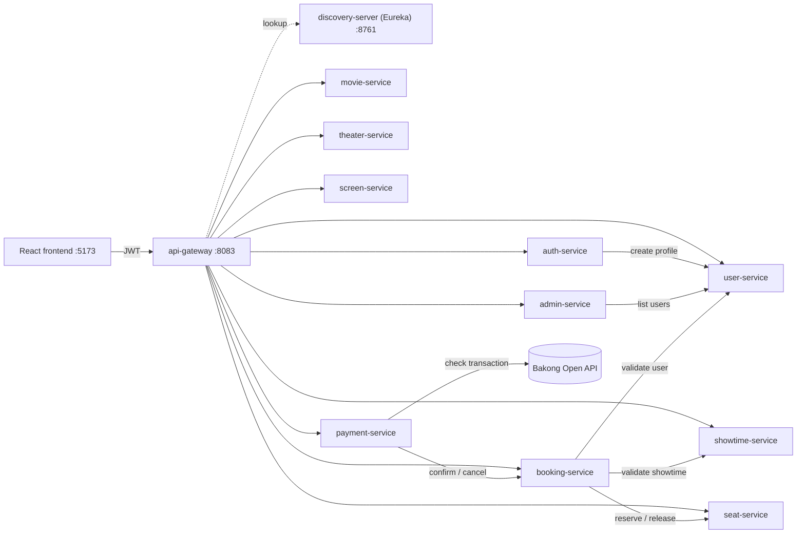

# CineBook — Movie Booking System

A movie-theater booking platform built as **Spring Boot microservices** with a
**React** front end. Customers browse movies, pick a showtime and a seat, book
it, and pay by scanning a **Bakong KHQR** code (Cambodia's national payment
QR). Admins manage the catalogue: movies, theaters, screens, showtimes and
seats.

## What problem it solves

Selling cinema tickets online looks simple until two people click the same seat
at the same moment, or a customer pays and closes the tab before the page hears
back. CineBook is built around getting those cases right:

- **No double booking.** A seat is reserved per showtime by a single atomic
  insert guarded by a `UNIQUE (showtime_id, seat_id)` key. When many users race
  for one seat, exactly one wins; everyone else gets a clean `409` and the seat
  map reloads. A concurrency test fires 16 threads at one seat to prove it.
- **One seat, many shows.** Booking A5 for the 2 PM show leaves A5 free for the
  8 PM show. Nothing has to be generated or reset per showtime.
- **Payment can't be faked.** Prices come from the seat, never from the
  request. A booking is confirmed only when Bakong itself reports the QR as
  paid, for the right account, amount and currency.
- **Money is never lost.** If a payment arrives while the booking service is
  down, the payment stays `PAID` and a background sweeper keeps retrying the
  confirmation. Unpaid QRs expire and release their seat automatically.
- **No stale bookings.** A showtime that has already started can't be booked,
  and a seat a live booking holds can't be deleted.
- **One failing service doesn't take everything down.** Calls between services
  have timeouts and circuit breakers, and each service has its own database.

It also works as a reference project for a realistic microservice setup:
service discovery, an API gateway with JWT auth and role checks, a saga with
compensating actions instead of distributed transactions, Flyway-managed
schemas, health probes and Docker Compose.

## Architecture



- The browser talks only to **api-gateway**, which validates the JWT, enforces
  roles (`USER` / `ADMIN`), handles CORS and routes by Eureka service name.
- **Twelve independent Maven projects**, each with its own MySQL database
  (nine of them) and no cross-service foreign keys.

| Service | Port | Owns |
| --- | --- | --- |
| discovery-server | 8761 | Eureka registry |
| api-gateway | 8083 | Routing, authentication, authorization, CORS |
| auth-service | 8082 | Credentials, login, access/refresh tokens, roles |
| user-service | 8090 | User profiles |
| movie-service | 8091 | Movies (`NOW_SHOWING`, `COMING_SOON`, `ARCHIVED`) |
| theater-service | 8084 | Cinemas |
| screen-service | 8085 | Screens (halls) in a theater |
| showtime-service | 8086 | Showtimes |
| seat-service | 8087 | Seat layout and per-showtime reservations |
| booking-service | 8088 | Bookings and the booking saga |
| payment-service | 8089 | Bakong KHQR payments and the settlement sweeper |
| admin-service | 8093 | Admin operations |

### How a booking works

1. `POST /api/bookings` → booking-service checks that the user exists and the
   showtime exists and hasn't started, then asks seat-service to reserve the
   seat for that showtime. The booking is created as `PENDING`.
2. `POST /api/payments/bakong` → payment-service builds a KHQR for the booking
   total.
3. The browser polls every 3 s, and a server sweeper every 30 s, asking Bakong
   whether the QR was paid. Paid → payment `PAID`, booking `CONFIRMED`.
   Expired → booking cancelled and the seat released.

There's no distributed transaction. If a step fails after the seat is reserved,
booking-service releases it as a compensating action.

## Tech stack

| Layer | Technology |
| --- | --- |
| Backend | Java 21, Spring Boot 4.1, Spring Cloud 2025.1 |
| Discovery / gateway | Netflix Eureka, Spring Cloud Gateway (WebMVC) |
| Security | JWT (HS256), Spring Security |
| Resilience | Resilience4J circuit breakers, HTTP timeouts |
| Data | MySQL 8.4, Flyway migrations |
| Payments | Bakong KHQR (NBC SDK) + Bakong Open API |
| Frontend | React 19, Vite, Tailwind CSS 4, React Router |
| Ops | Docker, Docker Compose, actuator health probes |

## Getting started

### Prerequisites

- Docker and Docker Compose
- Node.js (for the frontend)
- JDK 21 and Maven 3.9+ only if you build or run services outside Docker

### 1. Configure

```bash
cp .env.example .env   # set JWT_SECRET, MYSQL_ROOT_PASSWORD, BAKONG_* as needed
```

To try payments without a real Bakong account, set `BAKONG_MOCK=true`. The
checkout page then shows a **Simulate payment** button.

### 2. Start the backend

```bash
docker compose up -d --build --wait
```

Wait about 40 seconds after the containers are healthy. Until every service has
registered with Eureka, the gateway answers `500`.

Only these ports are published: the gateway on `8083`, Eureka on `8761` and
MySQL on `3307`.

### 3. Load demo data (optional)

```bash
bash scripts/seed-demo-data.sh    # creates movies, theaters, screens, seats, showtimes and an admin login
```

### 4. Start the frontend

```bash
cd movie-frontend
npm install
npm run dev                        # http://localhost:5173
```

Movie posters come from TMDB. Set a v4 bearer token in
`movie-frontend/.env` as `VITE_TMDB_TOKEN`. Without it the app still works,
just without images.

### Making the first admin

Admin rights can only be granted by an existing admin, so the first one is set
in SQL:

```sql
UPDATE auth_db.users SET role = 'ADMIN' WHERE username = 'your-username';
```

Then log in again so the new role is in your token.

## Testing

Each service has a Spring Boot context test. seat-service also has
Testcontainers tests for concurrent reservations, seat edits and delete guards,
which need Docker.

```bash
mvn clean test                                        # all modules (needs local MySQL on 3306)
cd seat-service && ./mvnw test -Dtest=SeatReservationConcurrencyTest
```

Against a running Docker stack, the scripts in `scripts/` check the system end
to end:

| Script | Checks |
| --- | --- |
| `smoke-test.sh` | Validation errors, 401s, public catalogue reads |
| `authz-check.sh` | A `USER` can't perform `ADMIN` actions |
| `resilience-check.sh` | Timeouts and the circuit breaker fire (stops user-service) |
| `health-check.sh` | All 12 health endpoints, including a MySQL outage |
| `frontend-ready-check.sh` | CORS preflight and the `userId` token claim |
| `clean-test-data.sh` | Removes test data (deletes all bookings, payments and users) |

## Known limitations

- **No ownership checks** on most endpoints. Any signed-in user can cancel any
  booking. Bakong payment creation is the exception.
- **Logout doesn't revoke tokens.** They stay valid until they expire (access
  15 min, refresh 7 days).
- **No seat hold timer.** An abandoned `PENDING` booking keeps its seat until
  it's cancelled or its QR expires.
- The Bakong Open API may only answer requests from Cambodian IP addresses.

## Further reading

- [`docs/project-overview.md`](docs/project-overview.md): the whole system,
  the booking and payment saga, and why it is built this way
- [`docs/service-communication.md`](docs/service-communication.md): RestClient,
  Eureka, timeouts and circuit breakers
- [`movie-frontend/README.md`](movie-frontend/README.md): the React client
